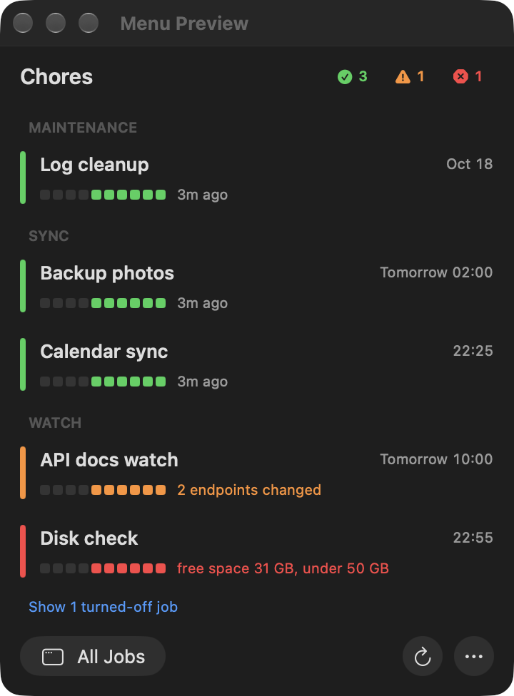
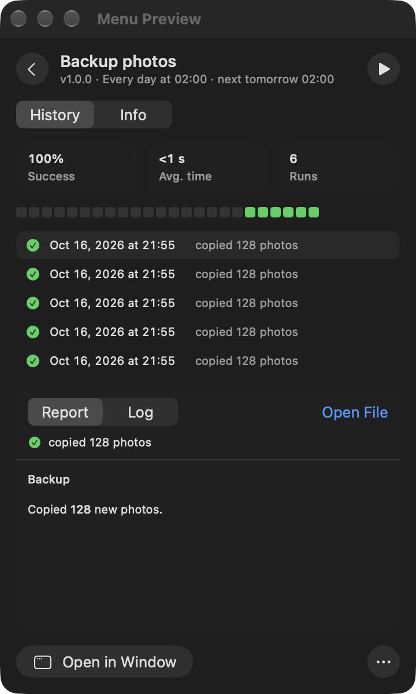
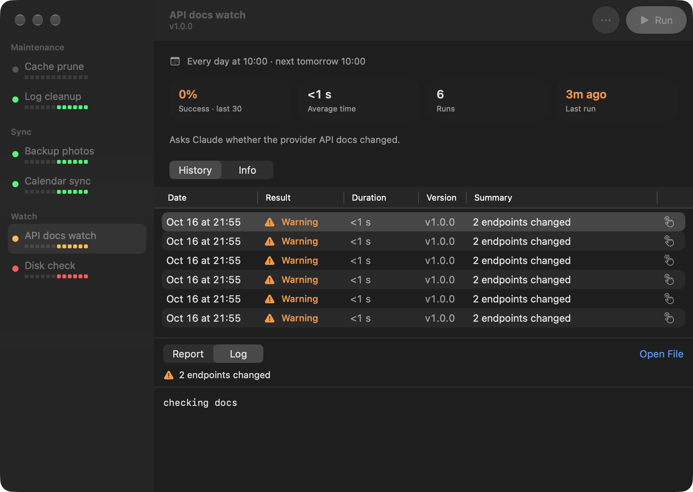
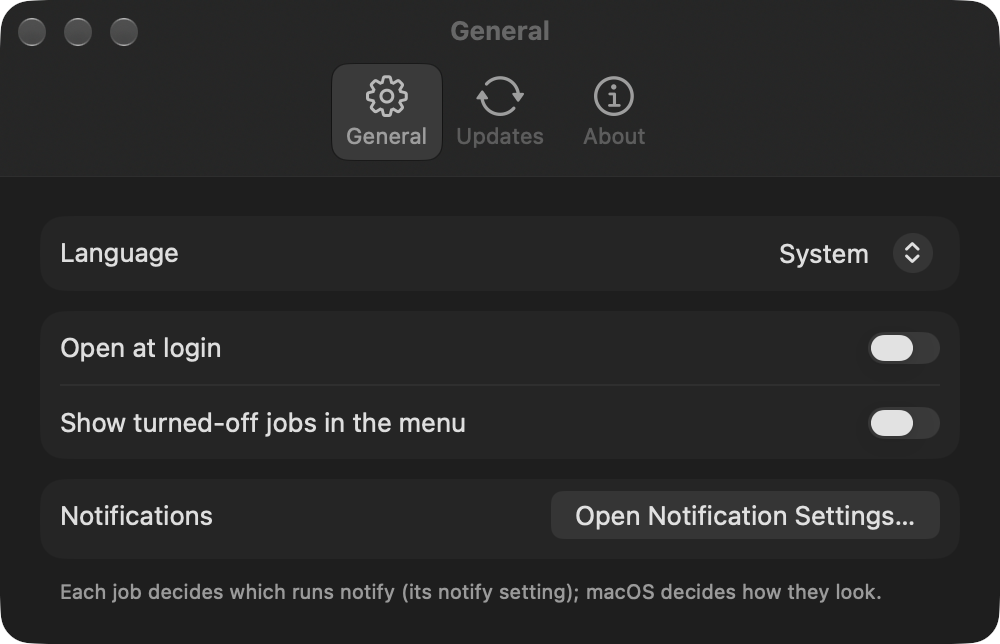

# Chores

**A native macOS menu-bar app that schedules, records and watches your background jobs** — the
nightly backups, hourly syncs and daily `claude -p` checks that pile up as scattered launchd
agents, each logging somewhere else, or nowhere.

Chores runs every job through one runner that records each run (start, end, exit code, outcome,
a one-line summary, the log and an optional report) and one scheduler inside the app that starts
them on time. The menu bar shows what ran, what failed and what runs next; a notification tells
you when something needs attention. A Claude Code skill sets new jobs up in the right shape, so
you ask for a job in plain words instead of writing plists.

<p align="center">
  
  &nbsp;
  
</p>

<p align="center">
  
</p>

## Features

- **One place for every job.** Jobs grouped by category with their last runs as a coloured strip,
  the latest summary and the next run time. The ok / warn / fail counts filter the list.
- **Run history that launchd never kept.** Every run's outcome, duration, summary, log and report
  in a window with a sortable history table. Select runs (Shift / ⌘) to delete them.
- **Notifications that do not nag.** Each job chooses which outcomes notify; a problem that
  repeats unchanged is reminded about at most once an hour.
- **Run, turn off, turn on** from the menu, the window or the `chores` CLI.
- **One login item.** A single scheduler agent inside the app replaces one launchd agent per job,
  so System Settings › Login Items shows one "Chores" row.
- **Updates itself** from the release tags of the repository it was built from.
- **English and Turkish**, following the system or chosen in Settings.

<p align="center">
  
</p>

## Requirements

- macOS 26 or later
- Xcode 26 or later (its Swift toolchain builds the app; there is no prebuilt download)
- [Claude Code](https://docs.claude.com/en/docs/claude-code) to create jobs with the skill
  (optional: a job is a folder with a `job.json`, which you can also write yourself)

## Install

```bash
git clone https://github.com/voyvodka/chores.git
cd chores
scripts/install.sh
```

`install.sh` builds the runner to `~/.local/bin/chores` and the app to `~/Applications/Chores.app`,
registers the scheduler and opens the app. The app adds itself to Login Items on first launch.
Allow notifications once in System Settings › Notifications › Chores.

Then give Claude Code the skill, for each Claude configuration you use:

```bash
mkdir -p ~/.claude/skills && ln -s "$PWD/skill" ~/.claude/skills/chores
```

## Create a job

Ask Claude Code for it: *"Every morning at 9, check whether the provider's API docs changed and
report what is new."* The `chores` skill writes the job folder, validates it and hands it to the
scheduler. It also moves an existing launchd agent under Chores when you ask.

A job is a folder in `~/.local/share/chores/jobs/<id>/`:

```
job.json   what it is: title, summary, command, schedule, timeout, notifications, version…
run.sh     the script (or whatever `command` runs)
```

The script reports its outcome by writing one line to `$CHORES_RESULT`, for example
`warn 2 endpoints changed`, and optionally the path of a report. A non-zero exit is always a
failure. [`skill/SKILL.md`](skill/SKILL.md) is the full contract.

## Command line

```text
chores list                        scheduler state, every job and its last run
chores run <id>                    run a job now in this terminal and record it
chores start|disable|enable <id>   the app's Run, Turn Off and Turn On
chores delete-runs <id> <run-id>… | --all
chores validate <id>               check a job.json
chores install|uninstall <id>      hand a job to the scheduler, or take it away
chores retire <label>              unload a pre-Chores launch agent, keeping its plist
chores paths                       where jobs, settings and logs live
```

## Updates

Once a day the app fetches the repository's release tags into its own clone
(`~/.local/share/chores/source`). When a newer `vX.Y.Z` exists it builds it, waits until no job is
running, installs it and reopens, then tells you how it went. Settings › Updates turns this off,
checks now and shows the log. Your own checkout is never touched; to run unreleased changes,
`git pull && scripts/install.sh` as before.

## Job templates

[`templates/`](templates) holds jobs meant for more than one Mac, each with its own `setup.sh`:

- [`inbox-watch`](templates/inbox-watch) reads a Gmail inbox twice a day (read-only) and has
  Claude report only the mails that need action. Its documentation and prompt are in Turkish.

## Uninstall

Quit Chores from its ⋯ menu, then:

```bash
~/Applications/Chores.app/Contents/MacOS/ChoresApp --unregister-scheduler
~/Applications/Chores.app/Contents/MacOS/ChoresApp --unregister-login-item
rm -rf ~/Applications/Chores.app ~/.local/bin/chores
rm -rf ~/.local/share/chores    # jobs, run history, settings and the update clone
```

## Development

```bash
swift build && swift test
.build/debug/ChoresApp --show-menu-preview    # the menu panel in a window, without installing
.build/debug/ChoresApp --show-window          # add CHORES_HOME=<folder> for test data
scripts/sync-strings.sh                       # bring the string catalog in line with the code
```

The package has three products: `ChoresKit` (the job contract and all logic, UI-free and unit
tested), the `chores` runner and `ChoresApp` (SwiftUI with AppKit where needed). UI strings are
English in code and translated in `Sources/ChoresApp/Resources/Localizable.xcstrings`; a test
fails on a missing translation. Changes go through pull requests with a type label and an entry
in [`CHANGELOG.md`](CHANGELOG.md); a `vX.Y.Z` tag on `main` is a release.

## License

[MIT](LICENSE)
